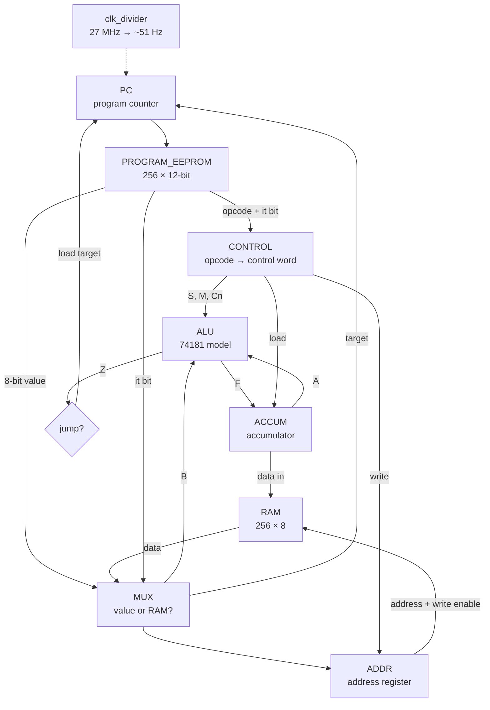

# CHUMP-8: an 8-bit CPU on an FPGA

An 8-bit version of the **CHUMP**, a simple teaching computer, rebuilt in Verilog on a **Tang Nano 9K (Gowin GW1NR-9) FPGA**.

I first built the 4-bit CHUMP on breadboards from 74LS-series chips, two EEPROMs and a 555 timer. This project is my own extension of it. Every chip became a Verilog module, and everything was widened to 8 bits: 256 instructions of program memory, 256 bytes of RAM and an 8-bit accumulator.


**On the board:** the CPU runs the [counter program](programs/README.md#1-counter). Each colour of LED shows a different part of the machine: the clock (top left), the program and control signals, RAM, and the accumulator output, which is the final result.

**Highlights**
- A complete single-cycle CPU: program counter, program ROM, control lookup table, ALU, accumulator, RAM and address register.
- An exact Verilog model of the **74181 ALU**, with all 16 logic and 16 arithmetic functions, the same chip used on the breadboard.
- **One flag for both jumps:** GOTO and IFZERO share the ALU's `A=B` output (see [How jumps work](#how-jumps-work)).
- Five [example programs](programs/README.md), from a running light to multiplication and Fibonacci, each shown as machine code, plain English, a flowchart and an LED picture.

<br clear="right"/>

---

## From breadboard to FPGA

Each breadboard chip maps onto one Verilog module:

| Job | 4-bit breadboard CHUMP | CHUMP-8 module | Change |
|---|---|---|---|
| Clock | 555 timer (astable/monostable) | `clk_divider.v` | 27 MHz ÷ 2¹⁹ ≈ 51 Hz (adjustable) |
| Program counter | 74LS161 | `PC.v` | 4 → 8 bits |
| Program memory | AT28C16 EEPROM | `PROGRAM_EEPROM.v` | 16 → 256 instructions, 8 → 12 bits wide |
| Control | AT28C16 EEPROM | `CONTROL.v` | Same idea: opcode in, control word out |
| Constant / RAM select | 74LS157 mux | `MUX.v` | 4 → 8 bits |
| Address register | 74LS174 | `ADDR.v` | 4 → 8 bits, plus the write-enable bit |
| RAM | 74189 (16 × 4) | `RAM.v` | 256 × 8 |
| ALU | 74LS181 | `ALU.v` | Same function table, 8 bits wide |
| Accumulator | 74LS377 | `ACCUM.v` | 4 → 8 bits |

---

## How it works



Each instruction takes **one clock cycle**:

1. The **program counter** picks an instruction from the program EEPROM.
2. The top 4 bits go to the **control** lookup table, which sets the ALU function, whether the accumulator loads, and whether RAM is written.
3. The **mux** picks the ALU's second input: either the 8-bit value in the instruction, or the byte in RAM at the current address (an `it` instruction).
4. On the clock edge, the **accumulator** stores the ALU result (if this instruction loads it), and the **program counter** either moves to the next instruction or jumps.

### Instruction format

```
 11 10  9   8    7 ................ 0
┌─────────┬────┬─────────────────────┐
│ opcode  │ it │       value         │
└─────────┴────┴─────────────────────┘
  3 bits    1         8 bits
```

`it = 0` means use the value. `it = 1` means use RAM at the current address instead (for example, `ADD it`).

### Instruction set

| Opcode | Instruction | What it does | Control word | S | M | C̄n | Load A | Write RAM |
|:---:|---|---|:---:|:---:|:---:|:---:|:---:|:---:|
| `000` | `LOAD x` | A ← x | `A9` | 1010 (F = B) | 1 | – | ✔ | |
| `001` | `ADD x` | A ← A + x | `95` | 1001 (A plus B) | 0 | 1 | ✔ | |
| `010` | `SUBTRACT x` | A ← A − x | `61` | 0110 (A minus B) | 0 | 0 | ✔ | |
| `011` | `STORETO x` | RAM[x] ← A | `02` | – | – | – | | ✔ |
| `100` | `READ x` | address ← x | `03` | – | – | – | | |
| `101` | *(unused)* | | `00` | | | | | |
| `110` | `GOTO x` | PC ← x | `CB` | 1100 (F = 1111 1111) | 1 | – | | |
| `111` | `IFZERO x` | if A = 0, PC ← x | `0B` | 0000 (F = NOT A) | 1 | – | | |

Control word bits: `[7:4]` ALU select S, `[3]` mode M (1 = logic), `[2]` C̄n (0 adds a carry-in, which subtract needs for A + NOT B + 1), `[1]` accumulator load (active low), `[0]` RAM write (active low).

### How jumps work

There's no separate comparator. The jump logic is just:

```verilog
assign LOAD_internal = (PRGM[11] & PRGM[10]) & Z;   // opcode 11x and the ALU's A=B output
```

`Z` is the 74181's `A=B` pin, which goes high when the ALU output is all 1s. The two jump instructions set up the ALU so that `Z` means the right thing:

- **GOTO** selects the function `F = 1111 1111`, so `Z` is always 1 and the jump always happens.
- **IFZERO** selects `F = NOT A`, which is all 1s only when A is `0000 0000`, so the jump happens only when the accumulator is zero.

### How RAM timing works

The address register copies `{write enable, mux output}` at every clock edge. That gives the CHUMP its programming style:

- `READ x` loads address x, so the *next* instruction can use `it` to read RAM[x].
- `STORETO x` puts the address and the write signal into the register together, so the write to RAM[x] happens during the following cycle.

See the [two rules for writing CHUMP code](programs/README.md#two-rules-for-writing-chump-code).

---

## Example programs

The [examples page](programs/README.md) walks through five programs, each in English, as a flowchart, as machine code and as an LED picture:

| | | |
|:---:|:---:|:---:|
| <br/>**Countdown** 10 → 0 | <br/>**Running light** | <br/>**Fibonacci** |

Here's the countdown in full:

| Addr | Binary (op · it · value) | Assembly | What it does |
|:---:|:---:|---|---|
| `00` | `000 0 00001010` | `LOAD 10` | A = 10 |
| `01` | `010 0 00000001` | `SUBTRACT 1` | A = A − 1 |
| `02` | `111 0 00000100` | `IFZERO 4` | if A is 0, we're finished |
| `03` | `110 0 00000001` | `GOTO 1` | otherwise keep counting down |
| `04` | `110 0 00000100` | `GOTO 4` | stop here (A stays at 0) |

---

## Hardware

**Board:** Sipeed Tang Nano 9K (GW1NR-LV9QN88PC6/I5), using its on-board 27 MHz clock, with LEDs on the output pins.

**Speed:** `clk_divider` uses bit 18 of a counter, giving 27 MHz ÷ 2¹⁹ ≈ **51 instructions per second**, slow enough to watch. Changing `CLK_DIV_BIT` speeds it up or slows it down.

### Pins ([`chump.cst`](src/chump.cst))

| Signal | Pins | Shows |
|---|---|---|
| `CLK_IN` | 52 | 27 MHz crystal |
| `CLK_OUT` | 63 | The CPU clock |
| `ACCUM_OUT[7:0]` | 77 – 70 | The accumulator (the result) |
| `Prgmcounter_OUT[7:0]` | 25, 26, 27, 28, 29, 30, 34, 33 | The program counter |
| `Program_OUT[11:8]` | 35, 41, 42, 51 | Opcode and `it` bit |
| `Program_OUT[4:0]` | 31, 57, 68, 32, 39 | Low bits of the instruction value |
| `RAM_OUT[3:0]` | 40, 38, 37, 36 | Low 4 bits of the RAM output |

The Tang Nano 9K doesn't have enough free pins for every signal, so `Program_OUT[7:5]`, `RAM_OUT[7:4]` and `MUX_OUT` aren't pinned out.

---

## Repository layout

```
├── src/
│   ├── TOP.v               # wires the CPU together
│   ├── clk_divider.v       # 27 MHz → ~51 Hz CPU clock
│   ├── PC.v                # program counter
│   ├── PROGRAM_EEPROM.v    # the program (counter)
│   ├── CONTROL.v           # opcode → control word
│   ├── MUX.v               # value or RAM select
│   ├── ADDR.v              # address register (+ write enable)
│   ├── RAM.v               # 256 × 8 RAM
│   ├── ALU.v               # 74181 model
│   ├── ACCUM.v             # accumulator
│   └── chump.cst           # pin constraints
├── programs/
│   ├── README.md           # the example programs explained
│   └── verilog/            # each example as a drop-in PROGRAM_EEPROM.v
└── docs/images/
```

## Build and run

1. Create a Gowin IDE project for **GW1NR-LV9QN88PC6/I5** and add every file in `src/`, with `TOP` as the top module.
2. To run a different program, replace `src/PROGRAM_EEPROM.v` with one from `programs/verilog/`.
3. Synthesize, place and route, then program the board.

---

## What I learned

- **How a CPU actually works.** Building the CHUMP on breadboards, then in Verilog, showed me the fetch-decode-execute cycle as real signals moving between chips.
- **Hardware description vs. wiring.** Each breadboard chip became a module with the same inputs and outputs, so `TOP.v` reads like the breadboard wiring, but changing the design takes seconds instead of re-wiring.
- **Scaling a design.** Going from 4 to 8 bits meant widening every bus and rethinking the instruction format, which grew from 8 to 12 bits.
- **Timing matters.** Because the address register updates every cycle, `READ` has to come right before an `it` instruction, and a `STORETO` lands one cycle late.

## Possible improvements

- Use the unused opcode `101` for a new instruction. The ALU already supports AND, OR and XOR, so a logic instruction only needs a new control word.
- Pass the ALU carry out to a flag, which would allow 16-bit maths and an `IFCARRY` jump.
- Read the program from a file (`$readmemb`) so programs can be swapped without editing Verilog.
- Show the accumulator on 7-segment displays, like the breadboard version.
