# CHUMP-8: an 8-bit CPU on an FPGA

An 8-bit version of the **CHUMP**, a simple teaching computer, rebuilt in Verilog on a **Tang Nano 9K (Gowin GW1NR-9) FPGA**.

I first built the 4-bit CHUMP on breadboards from 74LS-series chips, two EEPROMs and a 555 timer. This project is my own extension of it. Every chip became a Verilog module, and everything was widened to 8 bits: 256 instructions of program memory, 256 bytes of RAM and an 8-bit accumulator.

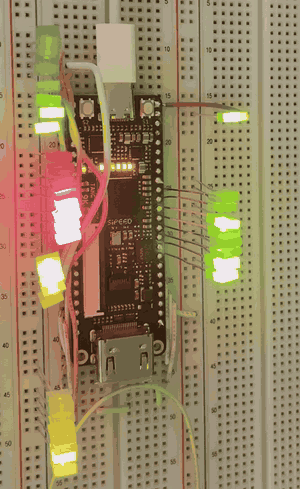

**On the board:** the CPU runs the [counter program](#1-counter). Each colour of LED shows a different part of the machine: the clock (top left), the program and control signals, RAM, and the accumulator output, which is the final result.

**Highlights**
- A complete single-cycle CPU: program counter, program ROM, control lookup table, ALU, accumulator, RAM and address register.
- An exact Verilog model of the **74181 ALU**, with all 16 logic and 16 arithmetic functions, the same chip used on the breadboard.
- **One flag for both jumps:** GOTO and IFZERO share the ALU's `A=B` output (see [How jumps work](#how-jumps-work)).
- Five [example programs](#example-programs), from a running light to multiplication and Fibonacci, each shown as machine code, plain English, a flowchart and an LED picture.
- Third version of the CHUMP I've built, after a [breadboard version and a 4-layer surface-mount PCB](#where-it-started-the-4-bit-chump).

<br clear="right"/>

---

## Where it started: the 4-bit CHUMP

CHUMP-8 is the third version of this computer I've built:

**1. Breadboard (4-bit).** I built the original from 74LS-series logic chips across several breadboards: a 74LS161 program counter, a 74LS181 ALU, a 74189 RAM, a 74LS377 accumulator, and two AT28C16 EEPROMs, one for the program and one for the control signals. A 555 timer provided the clock.

**2. EEPROM programmer.** To load the EEPROMs, I built an Arduino Nano programmer ([`history/eeprom-programmer`](history/eeprom-programmer/eeprom-programmer.ino)). It sets the address and data pins with bit shifting, then pulses write-enable low for each byte.

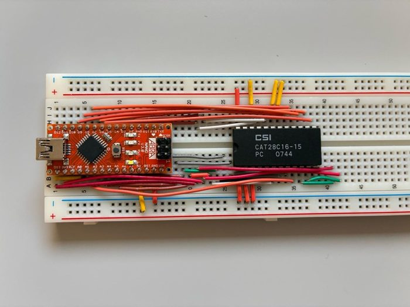

The breadboard design asked for each instruction to be shown as two hex digits on a pair of 7-segment displays. My teacher mentioned that nobody had ever driven both digits from a **single** EEPROM, so I worked out how:
- A **555 timer at about 4.8 kHz** flips one EEPROM address pin, so the EEPROM alternates between a "left digit" page and a "right digit" page.
- The same 555 signal switches the two displays' common cathodes, with one going through a transistor inverter, so only the matching display is on at each moment.
- The switching is far too fast to see (persistence of vision), so both digits look lit at once.

The data in the programmer is the machine code of my first CHUMP program, which adds three numbers: `04 62 02 63 08 64 82 10 83 30 84 30 65 CD`. A switch on another address pin selects a second program.

**3. Four-layer surface-mount PCB.** Next I redrew the whole breadboard computer as a 4-layer PCB in EasyEDA, using surface-mount versions of every chip: nearly **400 nets in under 50 cm²**. The autorouter ran for most of a day. I hand-soldered every chip with hot air to keep the cost down, and the board worked on the first try, apart from a couple of easy fixes.

| 4-layer routing | Hand-soldered SMD parts |
|:---:|:---:|
| 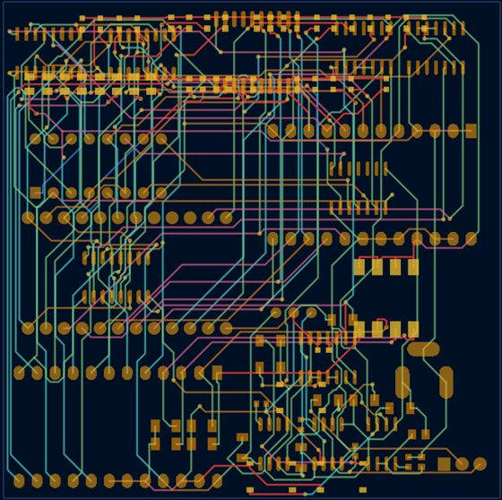 | 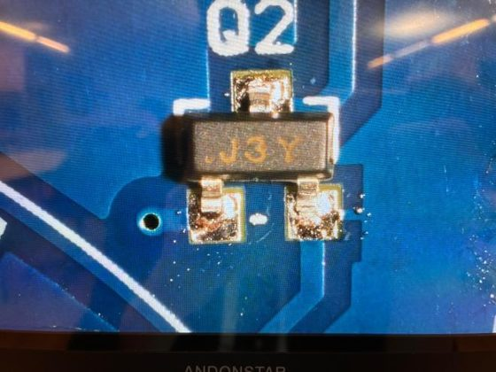 |

**4. FPGA (8-bit):** this repo. Every chip became a Verilog module, and every bus was doubled to 8 bits.

---

## From breadboard to FPGA

Each breadboard chip maps onto one Verilog module:

| Job | 4-bit breadboard CHUMP | CHUMP-8 module | Change |
|---|---|---|---|
| Clock | 555 timer (astable/monostable) | `clk_divider.v` | 27 MHz ÷ 2¹⁹ ≈ 51 Hz (adjustable) |
| Program counter | 74LS161 | `PC.v` | 4 → 8 bits |
| Program memory | AT28C16 EEPROM | `PROGRAM_EEPROM.v` | 16 → 256 instructions, 8 → 12 bits wide |
| Control | AT28C16 EEPROM | `CONTROL.v` | Same idea: opcode in, control word out |
| Constant / RAM select | 74LS157 mux | `MUX.v` | 4 → 8 bits |
| Address register | 74LS174 | `ADDR.v` | 4 → 8 bits, plus the write-enable bit |
| RAM | 74189 (16 × 4) | `RAM.v` | 256 × 8 |
| ALU | 74LS181 | `ALU.v` | Same function table, 8 bits wide |
| Accumulator | 74LS377 | `ACCUM.v` | 4 → 8 bits |

---

## How it works

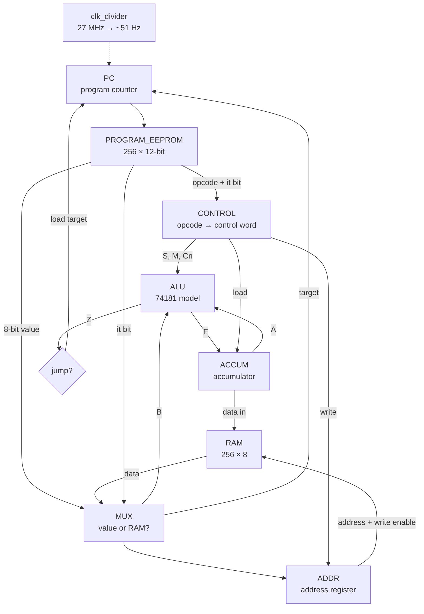

Each instruction takes **one clock cycle**:

1. The **program counter** picks an instruction from the program EEPROM.
2. The top 4 bits go to the **control** lookup table, which sets the ALU function, whether the accumulator loads, and whether RAM is written.
3. The **mux** picks the ALU's second input: either the 8-bit value in the instruction, or the byte in RAM at the current address (an `it` instruction).
4. On the clock edge, the **accumulator** stores the ALU result (if this instruction loads it), and the **program counter** either moves to the next instruction or jumps.

### Instruction format

```
 11 10  9   8    7 ................ 0
┌─────────┬────┬─────────────────────┐
│ opcode  │ it │       value         │
└─────────┴────┴─────────────────────┘
  3 bits    1         8 bits
```

`it = 0` means use the value. `it = 1` means use RAM at the current address instead (for example, `ADD it`).

### Instruction set

| Opcode | Instruction | What it does | Control word | S | M | C̄n | Load A | Write RAM |
|:---:|---|---|:---:|:---:|:---:|:---:|:---:|:---:|
| `000` | `LOAD x` | A ← x | `A9` | 1010 (F = B) | 1 | – | ✔ | |
| `001` | `ADD x` | A ← A + x | `95` | 1001 (A plus B) | 0 | 1 | ✔ | |
| `010` | `SUBTRACT x` | A ← A − x | `61` | 0110 (A minus B) | 0 | 0 | ✔ | |
| `011` | `STORETO x` | RAM[x] ← A | `02` | – | – | – | | ✔ |
| `100` | `READ x` | address ← x | `03` | – | – | – | | |
| `101` | *(unused)* | | `00` | | | | | |
| `110` | `GOTO x` | PC ← x | `CB` | 1100 (F = 1111 1111) | 1 | – | | |
| `111` | `IFZERO x` | if A = 0, PC ← x | `0B` | 0000 (F = NOT A) | 1 | – | | |

Control word bits: `[7:4]` ALU select S, `[3]` mode M (1 = logic), `[2]` C̄n (0 adds a carry-in, which subtract needs for A + NOT B + 1), `[1]` accumulator load (active low), `[0]` RAM write (active low).

### How jumps work

There's no separate comparator. The jump logic is just:

```verilog
assign LOAD_internal = (PRGM[11] & PRGM[10]) & Z;   // opcode 11x and the ALU's A=B output
```

`Z` is the 74181's `A=B` pin, which goes high when the ALU output is all 1s. The two jump instructions set up the ALU so that `Z` means the right thing:

- **GOTO** selects the function `F = 1111 1111`, so `Z` is always 1 and the jump always happens.
- **IFZERO** selects `F = NOT A`, which is all 1s only when A is `0000 0000`, so the jump happens only when the accumulator is zero.

### How RAM timing works

The address register copies `{write enable, mux output}` at every clock edge. That gives the CHUMP its programming style:

- `READ x` loads address x, so the *next* instruction can use `it` to read RAM[x].
- `STORETO x` puts the address and the write signal into the register together, so the write to RAM[x] happens during the following cycle.

See the [two rules for writing CHUMP code](programs/README.md#two-rules-for-writing-chump-code).

---

## Example programs

Five programs, each shown four ways: in plain English, as a flowchart, as machine code (the actual 1s and 0s in the program EEPROM), and as a picture of what the LEDs show while it runs. Each 12-bit instruction is split as `opcode · it · value` (see [Instruction format](#instruction-format)). To run one on the board, replace `src/PROGRAM_EEPROM.v` with the matching file from [`programs/verilog/`](programs/verilog) and rebuild in Gowin.

| Program | What it shows off |
|---|---|
| [1. Counter](#1-counter) | The original test program: ADD and GOTO |
| [2. Countdown](#2-countdown) | Decisions with IFZERO |
| [3. Running light](#3-running-light) | Using RAM to double a number, and 8-bit overflow |
| [4. Multiply](#4-multiply) | Variables in RAM, and a loop that counts |
| [5. Fibonacci](#5-fibonacci) | Juggling three variables in RAM |

### 1. Counter

**In English:** start at 0 and add 1 forever. A copy of the count is also stored in RAM[0]. This is the program the board runs in the [demo video](#chump-8-an-8-bit-cpu-on-an-fpga).

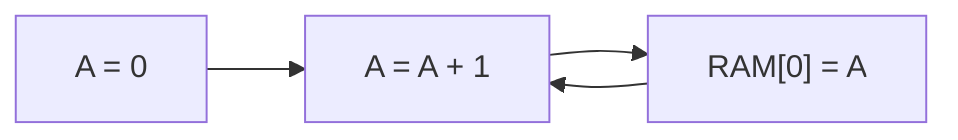

| Addr | Binary (op · it · value) | Assembly | What it does |
|:---:|:---:|---|---|
| `00` | `100 0 00000000` | `READ 0` | point the address register at RAM[0] |
| `01` | `000 0 00000000` | `LOAD 0` | A = 0 |
| `02` | `001 0 00000001` | `ADD 1` | A = A + 1 |
| `03` | `011 0 00000000` | `STORETO 0` | RAM[0] = A |
| `04` | `110 0 00000010` | `GOTO 2` | repeat |

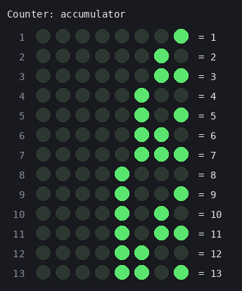

The loop is 3 instructions long, so the count goes up once every 3 clock ticks.

### 2. Countdown

**In English:** start at 10 and subtract 1 until the number reaches 0, then stop.

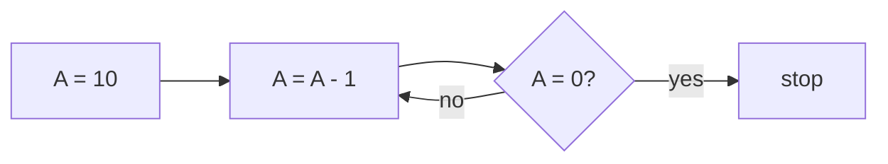

| Addr | Binary (op · it · value) | Assembly | What it does |
|:---:|:---:|---|---|
| `00` | `000 0 00001010` | `LOAD 10` | A = 10 |
| `01` | `010 0 00000001` | `SUBTRACT 1` | A = A - 1 |
| `02` | `111 0 00000100` | `IFZERO 4` | if A is 0, we're finished |
| `03` | `110 0 00000001` | `GOTO 1` | otherwise keep counting down |
| `04` | `110 0 00000100` | `GOTO 4` | stop here (A stays at 0) |

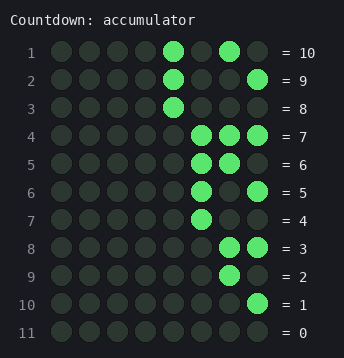

`GOTO 4` at address 4 jumps to itself, which is how a program "stops" on a CPU with no halt instruction.

### 3. Running light

**In English:** light up the rightmost LED, then keep doubling the number. In binary, doubling moves every bit one place left, so the light walks across the LEDs. After 128, doubling gives 256, which doesn't fit in 8 bits and wraps to 0. IFZERO notices this and starts over.

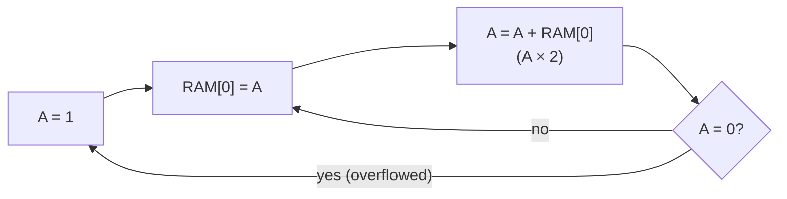

| Addr | Binary (op · it · value) | Assembly | What it does |
|:---:|:---:|---|---|
| `00` | `000 0 00000001` | `LOAD 1` | A = 00000001 |
| `01` | `011 0 00000000` | `STORETO 0` | RAM[0] = A |
| `02` | `100 0 00000000` | `READ 0` | point at RAM[0] (also lets the store land) |
| `03` | `001 1 00000000` | `ADD it` | A = A + RAM[0] = A × 2, the light moves left |
| `04` | `111 0 00000000` | `IFZERO 0` | 128 + 128 = 256 doesn't fit in 8 bits → 0, so restart |
| `05` | `110 0 00000001` | `GOTO 1` | move the light again |

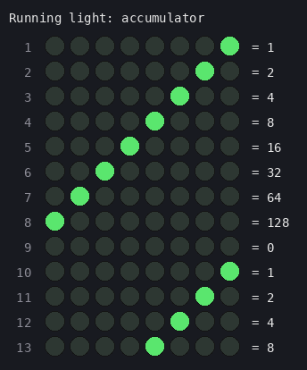

The CHUMP has no "add A to itself" instruction, so the program saves A to RAM first and then adds it back with `ADD it`.

### 4. Multiply

**In English:** the CHUMP can only add and subtract, so to work out 6 × 7 it adds 6 seven times. RAM[0] holds the running total and RAM[1] counts how many 6s are left. When the count reaches 0, the answer, 42, is loaded onto the LEDs.

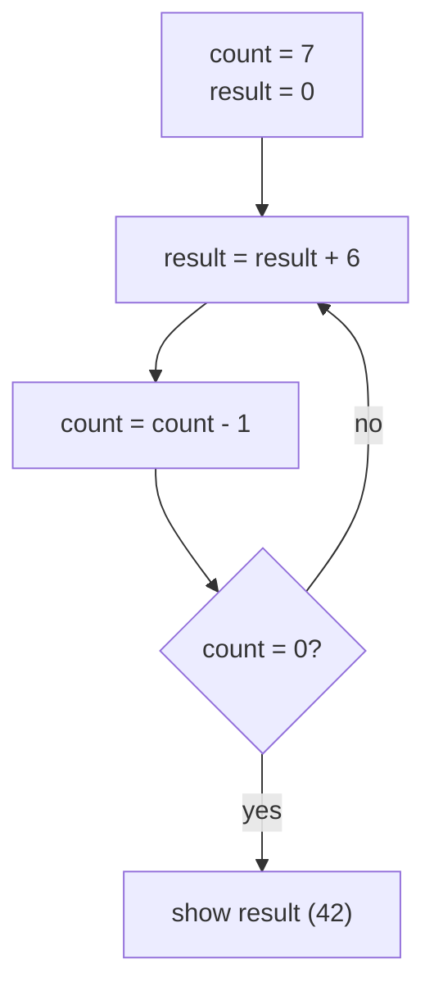

| Addr | Binary (op · it · value) | Assembly | What it does |
|:---:|:---:|---|---|
| `00` | `000 0 00000111` | `LOAD 7` | A = 7 |
| `01` | `011 0 00000001` | `STORETO 1` | count = 7 |
| `02` | `100 0 00000000` | `READ 0` | point at result |
| `03` | `000 1 00000000` | `LOAD it` | A = result |
| `04` | `001 0 00000110` | `ADD 6` | A = result + 6 |
| `05` | `011 0 00000000` | `STORETO 0` | result = A |
| `06` | `100 0 00000001` | `READ 1` | point at count |
| `07` | `000 1 00000000` | `LOAD it` | A = count |
| `08` | `010 0 00000001` | `SUBTRACT 1` | A = count - 1 |
| `09` | `011 0 00000001` | `STORETO 1` | count = A |
| `0A` | `111 0 00001100` | `IFZERO 12` | no 6s left? then we're done |
| `0B` | `110 0 00000010` | `GOTO 2` | add another 6 |
| `0C` | `100 0 00000000` | `READ 0` | point at result |
| `0D` | `000 1 00000000` | `LOAD it` | show the result on the accumulator LEDs |
| `0E` | `110 0 00001110` | `GOTO 14` | stop here |

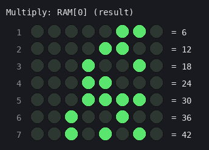

The picture shows RAM[0], the running total. While the loop runs, the accumulator LEDs flicker between the total and the count. They settle on 00101010 (42) when the program finishes.

### 5. Fibonacci

**In English:** each number is the sum of the two before it: 1, 2, 3, 5, 8, 13… RAM[0] and RAM[1] hold the last two numbers, and RAM[2] gets the new one. After 233, the next number (377) is too big for 8 bits, so it wraps around to 377 − 256 = 121. That's a nice way to see overflow.

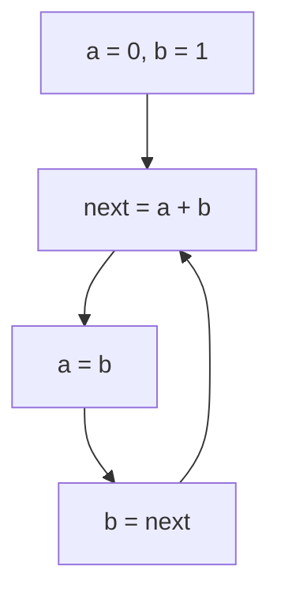

| Addr | Binary (op · it · value) | Assembly | What it does |
|:---:|:---:|---|---|
| `00` | `000 0 00000001` | `LOAD 1` | A = 1 |
| `01` | `011 0 00000001` | `STORETO 1` | b = 1 (a = RAM[0] starts at 0) |
| `02` | `100 0 00000000` | `READ 0` | point at a |
| `03` | `000 1 00000000` | `LOAD it` | A = a |
| `04` | `100 0 00000001` | `READ 1` | point at b |
| `05` | `001 1 00000000` | `ADD it` | A = a + b |
| `06` | `011 0 00000010` | `STORETO 2` | next = A |
| `07` | `100 0 00000001` | `READ 1` | point at b |
| `08` | `000 1 00000000` | `LOAD it` | A = b |
| `09` | `011 0 00000000` | `STORETO 0` | a = b |
| `0A` | `100 0 00000010` | `READ 2` | point at next |
| `0B` | `000 1 00000000` | `LOAD it` | A = next |
| `0C` | `011 0 00000001` | `STORETO 1` | b = next |
| `0D` | `110 0 00000010` | `GOTO 2` | work out the next number |

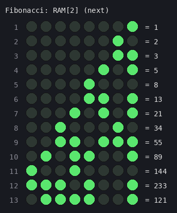

---

## Hardware

**Board:** Sipeed Tang Nano 9K (GW1NR-LV9QN88PC6/I5), using its on-board 27 MHz clock, with LEDs on the output pins.

**Speed:** `clk_divider` uses bit 18 of a counter, giving 27 MHz ÷ 2¹⁹ ≈ **51 instructions per second**, slow enough to watch. Changing `CLK_DIV_BIT` speeds it up or slows it down.

### Pins ([`chump.cst`](src/chump.cst))

| Signal | Pins | Shows |
|---|---|---|
| `CLK_IN` | 52 | 27 MHz crystal |
| `CLK_OUT` | 63 | The CPU clock |
| `ACCUM_OUT[7:0]` | 77 – 70 | The accumulator (the result) |
| `Prgmcounter_OUT[7:0]` | 25, 26, 27, 28, 29, 30, 34, 33 | The program counter |
| `Program_OUT[11:8]` | 35, 41, 42, 51 | Opcode and `it` bit |
| `Program_OUT[4:0]` | 31, 57, 68, 32, 39 | Low bits of the instruction value |
| `RAM_OUT[3:0]` | 40, 38, 37, 36 | Low 4 bits of the RAM output |

The Tang Nano 9K doesn't have enough free pins for every signal, so `Program_OUT[7:5]`, `RAM_OUT[7:4]` and `MUX_OUT` aren't pinned out.

---

## Repository layout

```
├── src/
│   ├── TOP.v               # wires the CPU together
│   ├── clk_divider.v       # 27 MHz → ~51 Hz CPU clock
│   ├── PC.v                # program counter
│   ├── PROGRAM_EEPROM.v    # the program (counter)
│   ├── CONTROL.v           # opcode → control word
│   ├── MUX.v               # value or RAM select
│   ├── ADDR.v              # address register (+ write enable)
│   ├── RAM.v               # 256 × 8 RAM
│   ├── ALU.v               # 74181 model
│   ├── ACCUM.v             # accumulator
│   └── chump.cst           # pin constraints
├── programs/
│   ├── README.md           # the example programs explained
│   └── verilog/            # each example as a drop-in PROGRAM_EEPROM.v
├── history/
│   └── eeprom-programmer/  # Arduino code that programmed the 4-bit CHUMP's EEPROMs
└── docs/images/
```

## Build and run

1. Create a Gowin IDE project for **GW1NR-LV9QN88PC6/I5** and add every file in `src/`, with `TOP` as the top module.
2. To run a different program, replace `src/PROGRAM_EEPROM.v` with one from `programs/verilog/`.
3. Synthesize, place and route, then program the board.

---

## What I learned

- **How a CPU actually works.** Building the CHUMP on breadboards, then in Verilog, showed me the fetch-decode-execute cycle as real signals moving between chips.
- **Hardware description vs. wiring.** Each breadboard chip became a module with the same inputs and outputs, so `TOP.v` reads like the breadboard wiring, but changing the design takes seconds instead of re-wiring.
- **Scaling a design.** Going from 4 to 8 bits meant widening every bus and rethinking the instruction format, which grew from 8 to 12 bits.
- **Timing matters.** Because the address register updates every cycle, `READ` has to come right before an `it` instruction, and a `STORETO` lands one cycle late.

## Possible improvements

- Use the unused opcode `101` for a new instruction. The ALU already supports AND, OR and XOR, so a logic instruction only needs a new control word.
- Pass the ALU carry out to a flag, which would allow 16-bit maths and an `IFCARRY` jump.
- Read the program from a file (`$readmemb`) so programs can be swapped without editing Verilog.
- Show the accumulator on 7-segment displays, like the breadboard version.
