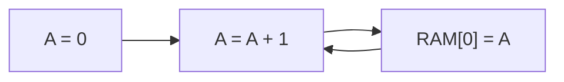
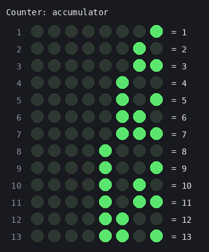
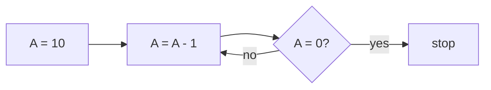
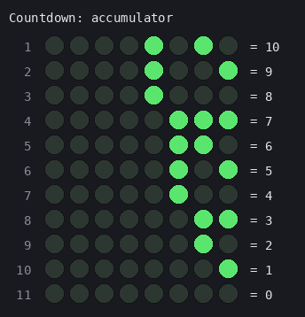
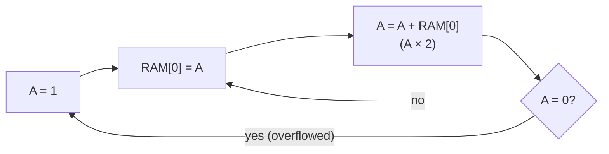
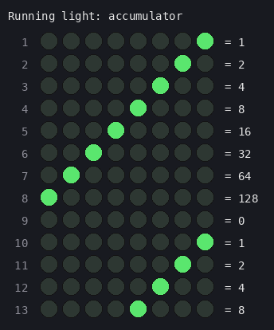
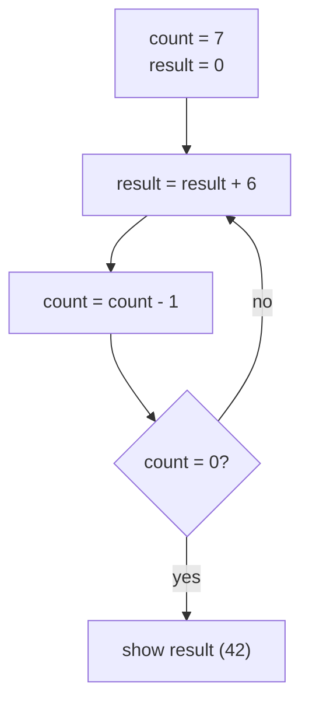
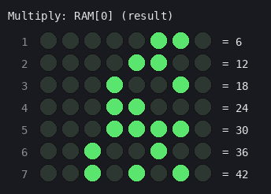
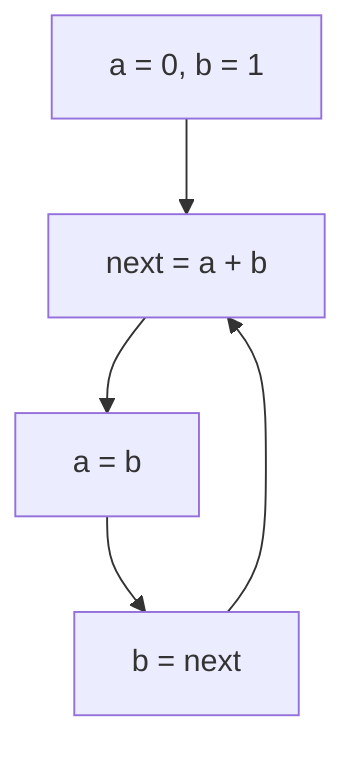
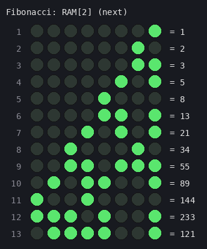

# Example programs

Five programs for the CHUMP-8, each shown four ways: in plain English, as a flowchart, as machine code (the actual 1s and 0s in the program EEPROM), and as a picture of what the LEDs show while it runs.

The LED pictures show the value of the accumulator (or a RAM cell) each time it changes while the program runs.

**Reading the binary:** each 12-bit instruction is split as `opcode · it · value`:

```
 111   0   00000100
 │     │   └── value: a number (0–255), a RAM address, or a jump target
 │     └────── it bit: 0 = use the value, 1 = use RAM at the current address instead
 └──────────── opcode: 000 LOAD, 001 ADD, 010 SUBTRACT, 011 STORETO,
                       100 READ, 110 GOTO, 111 IFZERO
```

**To run one on the board:** replace `src/PROGRAM_EEPROM.v` with the matching file from [`verilog/`](verilog), then rebuild in Gowin.

| Program | What it shows off |
|---|---|
| [1. Counter](#1-counter) | The original test program: ADD and GOTO |
| [2. Countdown](#2-countdown) | Decisions with IFZERO |
| [3. Running light](#3-running-light) | Using RAM to double a number, and 8-bit overflow |
| [4. Multiply](#4-multiply) | Variables in RAM, and a loop that counts |
| [5. Fibonacci](#5-fibonacci) | Juggling three variables in RAM |

---

## 1. Counter

**In English:** start at 0 and add 1 forever. A copy of the count is also stored in RAM[0]. This is the program the board runs in the [demo video](../README.md#demo).



| Addr | Binary (op · it · value) | Assembly | What it does |
|:---:|:---:|---|---|
| `00` | `100 0 00000000` | `READ 0` | point the address register at RAM[0] |
| `01` | `000 0 00000000` | `LOAD 0` | A = 0 |
| `02` | `001 0 00000001` | `ADD 1` | A = A + 1 |
| `03` | `011 0 00000000` | `STORETO 0` | RAM[0] = A |
| `04` | `110 0 00000010` | `GOTO 2` | repeat |



The loop is 3 instructions long, so the count goes up once every 3 clock ticks.

---

## 2. Countdown

**In English:** start at 10 and subtract 1 until the number reaches 0, then stop.



| Addr | Binary (op · it · value) | Assembly | What it does |
|:---:|:---:|---|---|
| `00` | `000 0 00001010` | `LOAD 10` | A = 10 |
| `01` | `010 0 00000001` | `SUBTRACT 1` | A = A - 1 |
| `02` | `111 0 00000100` | `IFZERO 4` | if A is 0, we're finished |
| `03` | `110 0 00000001` | `GOTO 1` | otherwise keep counting down |
| `04` | `110 0 00000100` | `GOTO 4` | stop here (A stays at 0) |



`GOTO 4` at address 4 jumps to itself, which is how a program "stops" on a CPU with no halt instruction.

---

## 3. Running light

**In English:** light up the rightmost LED, then keep doubling the number. In binary, doubling moves every bit one place left, so the light walks across the LEDs. After 128, doubling gives 256, which doesn't fit in 8 bits and wraps to 0. IFZERO notices this and starts over.



| Addr | Binary (op · it · value) | Assembly | What it does |
|:---:|:---:|---|---|
| `00` | `000 0 00000001` | `LOAD 1` | A = 00000001 |
| `01` | `011 0 00000000` | `STORETO 0` | RAM[0] = A |
| `02` | `100 0 00000000` | `READ 0` | point at RAM[0] (also lets the store land) |
| `03` | `001 1 00000000` | `ADD it` | A = A + RAM[0] = A × 2, the light moves left |
| `04` | `111 0 00000000` | `IFZERO 0` | 128 + 128 = 256 doesn't fit in 8 bits → 0, so restart |
| `05` | `110 0 00000001` | `GOTO 1` | move the light again |



The CHUMP has no "add A to itself" instruction, so the program saves A to RAM first and then adds it back with `ADD it`.

---

## 4. Multiply

**In English:** the CHUMP can only add and subtract, so to work out 6 × 7 it adds 6 seven times. RAM[0] holds the running total and RAM[1] counts how many 6s are left. When the count reaches 0, the answer, 42, is loaded onto the LEDs.



| Addr | Binary (op · it · value) | Assembly | What it does |
|:---:|:---:|---|---|
| `00` | `000 0 00000111` | `LOAD 7` | A = 7 |
| `01` | `011 0 00000001` | `STORETO 1` | count = 7 |
| `02` | `100 0 00000000` | `READ 0` | point at result |
| `03` | `000 1 00000000` | `LOAD it` | A = result |
| `04` | `001 0 00000110` | `ADD 6` | A = result + 6 |
| `05` | `011 0 00000000` | `STORETO 0` | result = A |
| `06` | `100 0 00000001` | `READ 1` | point at count |
| `07` | `000 1 00000000` | `LOAD it` | A = count |
| `08` | `010 0 00000001` | `SUBTRACT 1` | A = count - 1 |
| `09` | `011 0 00000001` | `STORETO 1` | count = A |
| `0A` | `111 0 00001100` | `IFZERO 12` | no 6s left? then we're done |
| `0B` | `110 0 00000010` | `GOTO 2` | add another 6 |
| `0C` | `100 0 00000000` | `READ 0` | point at result |
| `0D` | `000 1 00000000` | `LOAD it` | show the result on the accumulator LEDs |
| `0E` | `110 0 00001110` | `GOTO 14` | stop here |



The picture shows RAM[0], the running total. While the loop runs, the accumulator LEDs flicker between the total and the count. They settle on 00101010 (42) when the program finishes.

---

## 5. Fibonacci

**In English:** each number is the sum of the two before it: 1, 2, 3, 5, 8, 13… RAM[0] and RAM[1] hold the last two numbers, and RAM[2] gets the new one. After 233, the next number (377) is too big for 8 bits, so it wraps around to 377 − 256 = 121. That's a nice way to see overflow.



| Addr | Binary (op · it · value) | Assembly | What it does |
|:---:|:---:|---|---|
| `00` | `000 0 00000001` | `LOAD 1` | A = 1 |
| `01` | `011 0 00000001` | `STORETO 1` | b = 1 (a = RAM[0] starts at 0) |
| `02` | `100 0 00000000` | `READ 0` | point at a |
| `03` | `000 1 00000000` | `LOAD it` | A = a |
| `04` | `100 0 00000001` | `READ 1` | point at b |
| `05` | `001 1 00000000` | `ADD it` | A = a + b |
| `06` | `011 0 00000010` | `STORETO 2` | next = A |
| `07` | `100 0 00000001` | `READ 1` | point at b |
| `08` | `000 1 00000000` | `LOAD it` | A = b |
| `09` | `011 0 00000000` | `STORETO 0` | a = b |
| `0A` | `100 0 00000010` | `READ 2` | point at next |
| `0B` | `000 1 00000000` | `LOAD it` | A = next |
| `0C` | `011 0 00000001` | `STORETO 1` | b = next |
| `0D` | `110 0 00000010` | `GOTO 2` | work out the next number |



---

## Two rules for writing CHUMP code

1. **`READ` before `it`.** The address register copies the current instruction's value at every clock tick, so an `it` instruction uses the address from the instruction just before it. Put a `READ x` right before any `LOAD it` / `ADD it` / `SUBTRACT it`.
2. **Don't change A right after `STORETO`.** The RAM write happens during the *next* instruction, so that instruction shouldn't change the accumulator. `READ`, `GOTO`, `IFZERO` and another `STORETO` are all safe.
